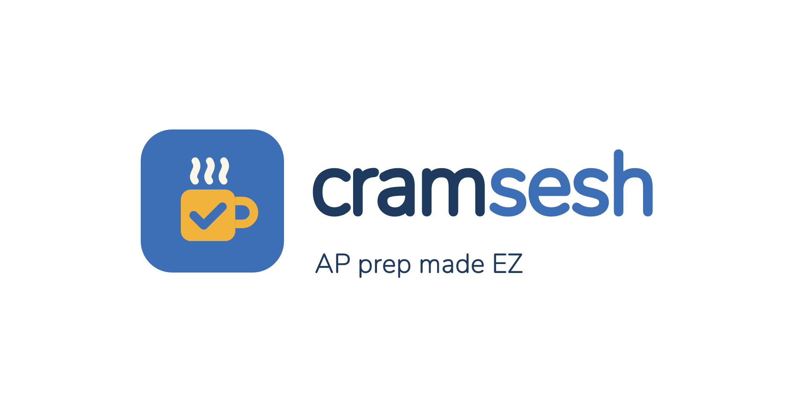
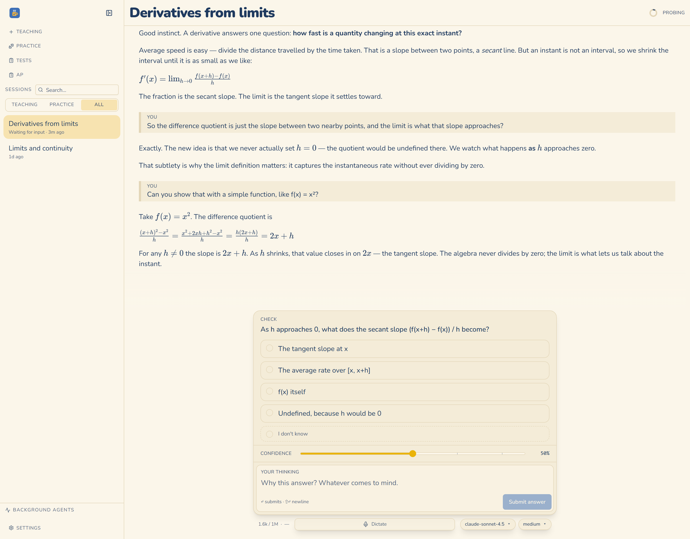
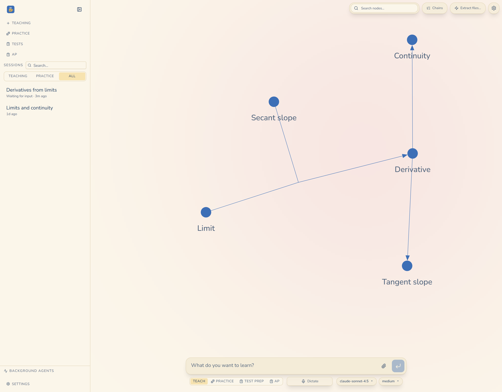

<p align="center">
  <picture>
    <source media="(prefers-color-scheme: dark)" srcset="docs/assets/cramsesh_banner_dark.png">
    <source media="(prefers-color-scheme: light)" srcset="docs/assets/cramsesh_banner_light.png">
    
  </picture>
</p>

<p align="center"><strong>AP prep made EZ.</strong></p>

Cramsesh is a study app for AP exams. It teaches a topic from where your understanding actually is, quizzes you on your reasoning, grades free-response work against official scoring, and keeps a knowledge graph of what you have learned.

## What it does

- **Teach.** A session starts by probing what you already understand, then plans a route to your goal and teaches one reasoning step at a time. Each step builds on something you already know, and the plan adapts when your understanding turns out different.
- **Quiz.** Practice and test-prep sessions pose problems that require the right knowledge to come to mind without being named first. You explain your reasoning as you work, and the tutor responds to how you reasoned, not just to the final answer.
- **Remember.** What you learn accumulates in a knowledge graph of claims and the premises that lead to them, with links back to the sessions that produced it. Later sessions can teach and set problems from it instead of starting from scratch.

## What Cramsesh adds

Cramsesh is a fork of LearnHarness rebuilt around AP exam prep, with a light mode and a warm cream-and-blue theme.

- **AP prep mode.** Add an AP course by name; the tutor finds College Board's current Course and Exam Description, saves it, and proposes the official units and topics for you to confirm. Readiness is tracked per topic, per unit and per course across sittings.
- **Released free-response questions.** Practise real released College Board free-response questions, with the official scoring guideline used for grading. The question appears as the original paper page, so figures and formatting are exactly the official ones.
- **Generated free-response questions.** When no unused released question covers a topic, the tutor writes a new free-response question in the AP style, complete with the solution and the full rubric.
- **Drawn figures.** A question that needs a graph, diagram or construction gets a figure drawn and checked before the question is asked.
- **Grading of your reasoning.** Free-response work is graded every scoring point, point by point, against the official rubric or the tutor's committed rubric. A right answer with missing working or justification earns no point. Multiple-choice reasoning is graded too: a right pick reached by flawed reasoning counts as a miss.
- **Direct web search.** Every conversation tutor can search the web and read a page inside its reply when a fact may have changed. A switch under Settings → Agent turns this off.
- **The rest of the fork's work.** Light mode and readability fixes, a running token counter for each session, Teach from your materials (the teacher uses the files and folders you point it at), Test prep mode with an outline and readiness tracking, a visual file and folder picker in the web version, and Windows scripts for setup, autostart and data sync.

## Screenshots

A teaching session: the tutor explains the limit definition, then checks the reasoning with a question.



The knowledge graph: ideas from your sessions, and the reasoning chains that connect them.



## Download

Windows and Linux builds are on [GitHub Releases](https://github.com/Kevin09sun/cramsesh/releases).

- **Windows (x64):** run the installer. It is unsigned, so Windows may show a SmartScreen warning — choose **More info → Run anyway**.
- **Linux (x64):** make the AppImage executable and open it, or install the Debian/Ubuntu `.deb`.
- **macOS:** not available in 1.0.0. A Mac build is coming later.

Packaged Windows and Linux builds check for updates from the same releases feed and can install them in the app.

**Former LearnHarness desktop users:** quit and uninstall the old desktop app before launching Cramsesh. Cramsesh has its own app identity; it uses an existing LearnHarness profile only when no Cramsesh profile exists yet, so your sessions and settings stay where they are.

## Run from source

You need Node.js and npm. CI and release builds use Node 26.

```bash
npm ci
npm run dev        # http://localhost:3000
npm test           # fixtures and fake providers
```

See the [documentation index](docs/README.md) for all guides, [development](docs/development.md) for setup and checks, [getting started](docs/getting-started.md) for model setup, files and notes imports, and [desktop builds and releases](docs/desktop-release.md) for packaging.

## Your keys, your data

- **Your keys and models.** There is no Cramsesh subscription or markup. Use provider API keys, supported subscription connections in the desktop app, an installed [Claude Code CLI](docs/claude-code.md), or a [custom OpenAI-compatible endpoint](docs/custom-providers.md), including a local model server. Billing depends on your provider, CLI configuration, subscription, or local setup.
- **Local storage.** Your chats, graph, settings and API keys live on your machine. Learning records are plain files you can inspect.
- **External services.** Models run through your configured providers. Model requests send the context needed for the task; web lookups, background research and dictation also contact external services. Local storage does not mean offline processing.
- **Inspectable behavior.** System prompts are visible and editable. The app is open source under the AGPL-3.0 license.

## Built on LearnHarness

Built on LearnHarness by Amos Blomqvist. Cramsesh is a fork of [LearnHarness](https://github.com/amosblomqvist/learnharness). Thank you to Amos and to the LearnHarness contributors for the teaching harness, the graph and the sessions this fork is built on. What Cramsesh changed is listed under [What Cramsesh adds](#what-cramsesh-adds).

## License

[AGPL-3.0](LICENSE). Cramsesh keeps the original's license, and changes to it are released under the same terms.
