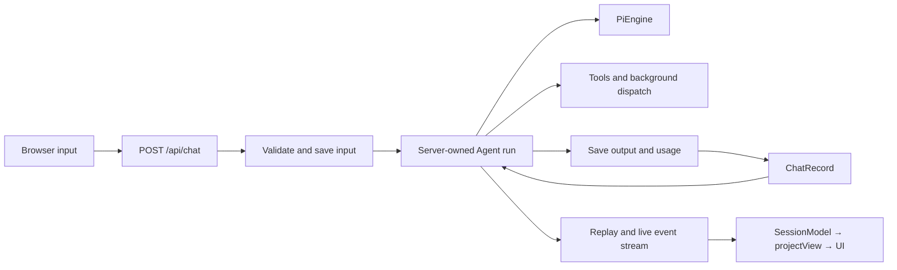
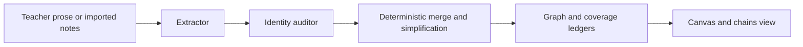

# Architecture

Cramsesh is a Next.js application with an Electron desktop host. The server owns agent runs, conversation records, background work, and filesystem persistence; the browser projects those records into a lesson/practice UI and knowledge graph.

This reference describes the [repository source](README.md#about-these-docs). See [Development](development.md) for commands and [the teaching theory](teaching-methodology.md) for pedagogical intent.

## Code boundaries

| Area | Responsibility / starting points |
| --- | --- |
| `app/` | Pages and HTTP transport; `api/chat/route.ts`, `api/chats/` |
| `components/` | Browser state and presentation; `session-core.ts`, `chat.tsx`, `graph-view.tsx` |
| `src/server/` | Composition, admission, liveness, HTTP-facing services; `chat-handler.ts`, `jobs.ts`, `stores.ts` |
| `src/agent/` | Agent construction, tools, provider streams, workers; `teacher-agent.ts`, `models.ts`, `tools.ts`, `subagents/` |
| `src/core/` | Contracts, record/view projections, domain algorithms; `input-events.ts`, `native-messages.ts`, `view.ts`, `graph.ts` |
| `src/store/` | Filesystem adapters for chats, jobs, graph, settings, and credentials |
| `electron/` | Desktop launch, navigation/permission guards, credential transport, browser helper, updater |

[`eslint.config.mjs`](../eslint.config.mjs) restricts shell imports into `src/` to the core/server barrels, prevents core imports from IO layers, and prevents agents importing server/store adapters. Dependencies arrive through injected contexts/ports. These rules are not a proof of pure core, one composition root, or one writer per store: some core modules are Node-bound and excluded from the browser barrel; server modules can import adapters. Scripts, Electron, and tests are outside these zones.

## Conversations and turns

A **conversation** is a durable `ChatRecord` with native `LhMessage[]`, settings, optional plan, and usage logs. Missing `kind` means teaching; `practice` selects the practitioner; `testprep` and `ap` select their prep tutors and records. An **engine** is the resolved Pi model, stream function, and thinking level. An application **turn** constructs a fresh native Pi `Agent` from saved history; it can make several model calls and execute tools. It is not an HTTP connection or a single generation.

[`chat-handler.ts`](../src/server/chat-handler.ts) resolves readiness, waits for compaction, re-reads durable truth, and claims per-chat liveness. A competing turn gets **409**. Accepted input is saved before inference; subscription automatic inputs can instead remain staged until dispatch admission. The HTTP response acknowledges admission, while `GET /api/chats/:id/stream` carries replay/live events and a terminal state.

The stored record has two projections:

- [`toLlmMessages`](../src/core/native-messages.ts) strips app metadata, flattens model-facing markers, applies the active compaction cut, and repairs eligible interrupted tool pairs at the provider boundary.
- [`projectView`](../src/core/view.ts) derives UI messages, question/problem docks, and artifacts. It is not the stored format or provider wire.

Pi seeds the system prompt/tools at construction; that synthetic system message is not persisted. New turns therefore get current instructions. The app does not use the AI SDK's client-transcript replacement or `addToolOutput` loop.

Settlement persists new native messages, plan snapshots, and usage, including partial output on abort. Failed input writes refuse inference; failed reply writes are surfaced before the terminal and do not masquerade as successful empty turns. Cleanup releases liveness. A memory-only failure notice can inform reattaching views without fabricating saved transcript content.

### Streaming and recovery

[`pi/ui-stream.ts`](../src/server/pi/ui-stream.ts) emits native agent events. Partial-message updates replace a slot; they are not accumulated text deltas. Replay retains settled events and the latest in-flight updates, with coalesced live fan-out. Tool IDs are uniquified against history so persistence, answer routing, and provider context agree.

Disconnecting a browser detaches a view, not the agent. Explicit abort is separate. [`session-core.ts`](../components/session-core.ts) owns reattachment, bounded 409 recovery, and adoption of canonical state. One recovery attachment is allowed after premature EOF/read failure; repeated transport failure shows an error.

Question drafts survive optimistic unmount in memory. Uncertain submissions reconcile the saved record and running state before resending, scoped to the same question occurrence. Provider-response retry is explicit: it preserves failed attempts on disk while omitting the eligible failed tail from temporary model context. It is not mount-time replay or automatic retry of arbitrary failures.

## Teaching and practice

[`teacher-agent.ts`](../src/agent/teacher-agent.ts) and the [tool registry](../src/agent/tools.ts) compose different agents over the same teaching history:

| Agent | Interaction | Other tools |
| --- | --- | --- |
| Prober | `probe` or `recall`, `ask_user_question`, `probe_done` | Read-only files, research/PDF dispatch; gated graph readers |
| Teacher | `quiz` or `explain`, `ask_user_question`, `plan_init` | Read-only files, research/PDF/demo/visual dispatch; `show_image` |
| Practitioner | `problem`, `conclude` | Read-only files, research/PDF dispatch; gated graph readers |

Mechanic choices, settings toggles, and readiness affect availability. Practice side tools are composed separately from teaching toggles. Claude-family agents can receive `send_to_user`. Argument healing precedes semantic validation; invalid calls return errors the model can correct.

Question tools validate and execute server-side, returning a synthetic terminating placeholder. It stops a clean question pose, including mixed tool batches, but is not saved. The actual learner answer becomes the call's result later. The browser shuffles options and grades select questions; free recall exposes the committed answer for model judgment. Sibling pending questions are answered without inference until the last is resolved.

A matching successful `probe_done` result selects the teacher and queues a fresh-agent handoff. A bare/refused call does not. Planning begins at that seam; displayed teaching begins at the first node-tagged `quiz`/`explain`, not `plan_init`. The plan is a validated Mermaid DAG, replaceable through `plan_init`. Current/visited positions derive from tagged calls, not grades. Waiting for the learner's natural reply to the plan is prompt doctrine, not an acceptance transaction.

Practice uses the same turn/persistence/recovery path, not a separate problem-set service. [`tools/practice.ts`](../src/agent/tools/practice.ts) commits a statement and solution with `problem`; `conclude` records the outcome and reveals that solution. A turn-scoped gate enforces one active problem. The post-conclusion pause is doctrine, not a terminating `conclude` result. Next adds an explicit marker. Practice outcomes are session evidence, not graph mastery; ordinary practice settlement skips extraction.

### AP prep

AP is a fourth session kind (`ap`) for one exam course. A course record holds its units and official numbered topics — the same section/point shape Test prep uses, so [`core/test-prep.ts`](../src/core/test-prep.ts) supplies the status machine, queue order, readiness and plan merge unchanged. [`core/ap.ts`](../src/core/ap.ts) adds the sitting scope (one topic, one unit, or weak topics across units), the scoped queue and the session label.

Each practice sitting is its own AP session, linked to the course and carrying its scope and question kind; setup is a separate session linked to the same course. The registry in [`tools/ap.ts`](../src/agent/tools/ap.ts) saves the official course description and released papers, reads stored PDFs, proposes the unit and topic list for confirmation, reports progress and the queue (`ap_progress`), poses multiple-choice (`ap_mcq`) and free-response questions — released (`ap_frq`) or written by the tutor (`ap_frq_gen`) — grades a free-response answer point by point against the official or the committed rubric (`ap_rubric`, `ap_record_frq`, `ap_record_gen`), corrects a part's topic tag (`ap_retag_part`), shows the tutor a learner photo (`ap_view_photo`), draws a figure with the existing `visual` job and shows the tutor a finished one (`ap_view_figure`), and starts indexing (`ap_index_papers`). The committed correct option and option notes are never presented: the multiple-choice card withholds any verdict, and the tutor's reply is the verdict.

The course record is [`store/ap-courses.ts`](../src/store/ap-courses.ts), at `data/ap/<id>.json`. It holds the plan, each topic's status and attempt history, and a manifest of official documents — not their bytes — and it syncs with the rest of `data/`.

Official PDFs live in a separate local store at `data/ap-papers/<courseId>/` ([`server/ap-papers.ts`](../src/server/ap-papers.ts)). They are deliberately unsynced (`ap-papers/` in `data/.gitignore`): the bytes and anything rebuilt from them can be downloaded again, so only the manifest travels with the course record. A course opened where a document is missing shows it on the course page and offers a fresh download. The download accepts only College Board addresses, checked on the requested URL and every redirect hop, and writes atomically.

**The released-question index.** Real free-response questions come from a synced index at `data/ap-index/<courseId>.json` ([`store/ap-index.ts`](../src/store/ap-index.ts)); the shape, ids, titles and per-topic scoring rules live in [`core/ap-frq.ts`](../src/core/ap-frq.ts). Unlike the papers, the index is learning data and syncs with `data/`. `isApQuestionIndex` validates the whole file before every write — a paper insert and a retag alike — because a malformed question would make every later read return null. The store reads a missing, unreadable or invalid file as null and never rewrites what it did not parse; writes are atomic and announce `ap-changed`.

**Indexing.** `ap_index` is a background job ([`subagents/runner.ts`](../src/agent/subagents/runner.ts)) run by the `apIndexer` role, fixed to the Cheap model slot in [`core/settings.ts`](../src/core/settings.ts). [`subagents/ap-indexer.ts`](../src/agent/subagents/ap-indexer.ts) extracts every page of one paper and its scoring guideline to text, fails a pair honestly when it is unreadable (scanned) or too long, and validates the submitted index — page bounds, part labels, confirmed topic tags and non-empty point lists — before returning it. The runner writes a pair only after its whole index is accepted, so an abort or a rejection never leaves half an index behind; papers already indexed are skipped.

**Page images.** `GET /api/ap/[id]/pages/[file]/[page]` serves one original page ([`server/ap-pages.ts`](../src/server/ap-pages.ts)). The page is painted once at 150 dpi with the headless PDF engine, cached under `data/ap-papers/<courseId>/pages/`, and answered `private, no-cache`. The route serves only a manifest `frq` or `ced` document's file; a scoring guideline is always a 404. When a paper is re-saved its cached pages are cleared ([`server/ap-papers.ts`](../src/server/ap-papers.ts)), so old bytes never show behind the new file.

**Question display and the rubric gate.** `GET /api/ap/[id]/questions/[qid]` returns the browser projection: title, paper file, pages, whether the paper is present, and each part's label with its confirmed topic text. It deliberately carries no rubric — no point text, point ids or scoring pages. `ap_frq` names a question by id and nothing else; everything the learner sees is assembled by the server from the index and the paper. The tutor reaches the rubric only through `ap_rubric`, which refuses until `answeredFrq` reports that the learner answered that question in this chat, and is never given a card that prints its raw input or output. During a sitting the three PDF readers are wrapped by `gateScoringGuideline`, which allows only the course description and released `frq` papers filed directly in the course's papers folder, matched by stored name, so the scoring guideline cannot be opened directly. The index folder is also app-private to the generic learner file tools ([`tools/fs-shared.ts`](../src/agent/tools/fs-shared.ts)): `read`, `ls`, `find` and `grep` refuse `data/ap-index/`, so rubric point text never leaks through a file read. The papers folder stays readable, because Learn sessions read the course description from it.

**Recording once, and images in the record.** `ap_record_frq` is gated to one recording per answered pose: it compares the course record's attempts for this chat with `answeredFrqCount`, the number of real, non-dismissed `ap_frq` answers in the chat, so replaying a turn cannot record the same answer twice. The score card renders only from the recorded result's details and nothing else. In an AP turn, `persistTurn` replaces each image content part in a saved tool result with one text note ([`server/turn-service.ts`](../src/server/turn-service.ts)); the live turn keeps the image so the tutor can grade against it, and the session record — which syncs — never carries the bytes.

**Generated free-response.** A question the tutor writes travels whole in the `ap_frq_gen` call — title, stem, one to six parts, and the committed answer and rubric points — exactly as `ap_mcq` carries its answer key. No screen prints that input: the live form and the answered card read only the title, the stem, each part's label and prompt, `details` and the figure. Grading reads the committed points by the same all-points rule as a released question, and `ap_record_gen` records the result once; the same score card renders from it.

**Figures.** The tutor starts the existing `visual` job, and a finished drawing arrives in the chat as it does in Teach. `ap_mcq` and `ap_frq_gen` accept a figure only by the job id of a finished `visual` job in the same chat, and only after `ap_view_figure` succeeded for that id in this session; a look earlier in the same turn counts before the saved record knows it. `GET /api/chats/[id]/figures/[jobId]` serves that drawing as a PNG rasterised from the stored SVG, never the SVG text, and answers 404 for another chat's job, another job kind, or an unfinished or failed drawing. The `visual` Settings switch removes the drawing tool from AP as it does from Teach, and a model that cannot see images cannot check a figure, so the tutor writes figure-free questions.

**Known limits, stated plainly.** The rubric gate is a server gate, not a sandbox. A tutor could still read an earlier session's saved rubric text from `data/chats`, or fetch a public scoring guideline from the web. And `ap_rubric` returns the guideline's pages for the question, which can include a sibling question's points printed on the same page.

[Prompt composition](../src/agent/prompts/README.md) and [tool-content display recovery](tool-content-recovery.md) have separate references.

## Background work

Research, PDF, demo, and visual tools persist jobs, acknowledge dispatch, and start independent workers through [`subagents/runner.ts`](../src/agent/subagents/runner.ts). Demos are checked using the browser helper; visuals use render-and-inspect loops. PDF/SVG rendering is native; demo execution uses Electron's browser service with system Chrome fallback.

Worker completion and session delivery are separate. The worker saves its outcome and pending-delivery metadata before queueing a marker. [`server/jobs.ts`](../src/server/jobs.ts) delivers by steering a live agent at a native boundary or waking an idle, eligible session. Pending questions, pause, consent, or admission races can hold delivery. Only computing workers are abortable.

A marker in the **saved conversation** acknowledges delivery—not HTTP acceptance or visibility in a stream. Reconciliation avoids replaying saved results; restart recovery restores known pending obligations and can respawn unfinished workers. Legacy terminal jobs without delivery metadata are not guessed into replay. Deleting a session discards its obligations.

This is single-process coordination over JSON files, not a transactional queue or exactly-once provider execution. In-memory composer steers do not have the same durability as job delivery.

### Learner-image snapshots

`show_image` displays a local raster picture; `visual` with an image path annotates it. Both use the file-access policy and shared processing: input bounds of 25 MiB, 16 megapixels, and 8192px per side; off-thread orientation/metadata cleanup; stored PNG/JPEG bounded to 1600px per side and below 1 MiB of base64.

[`learner-image.ts`](../src/agent/tools/learner-image.ts) stores processed bytes under SHA-256 identities in `ChatRecord.imageSnapshots`, deduplicated per session. Cards and annotation SVGs reference snapshots, so moving the original does not break saved results. Session-scoped image reads resolve references; SVG downloads embed their image. The annotator edits a placeholder href, not base64, and uses static native rendering. Ordinary visual SVGs retain their existing behavior. Offline regression tests exercise snapshot storage, display, and payload delivery, not model-driven annotation quality.

## Knowledge graph and imports

The graph records objective propositions and jointly-entailing reasoning chains, not learner understanding levels. Construction is post-hoc and independent of the lesson plan:

[`coverage.ts`](../src/core/coverage.ts) fingerprints teacher prose, including successful `send_to_user` text, by actual message ID. Learner text, thinking, questions, other tool results, and markers do not count. Automatic extraction is gated by `graph.enabled` and an uncovered-token threshold (default **4096**, minimum **500**). Rendering is a separate switch. Manual extraction/import routes do not themselves check the automatic-extraction switch.

The pipeline batches oldest uncovered messages without splitting one message. Trigger and batch budgets are distinct: current app wiring does not inject the configurable trigger value as the batch budget. Each source's batches run serially; cross-source work can overlap under a background-LLM semaphore. A process-wide FIFO lock serializes audit through merge. These registries survive module entries through `globalThis`, not separate server processes.

The [extractor](../src/agent/subagents/extraction.ts) reads source text and proposes anchored propositions/chains. The auditor sees propositions and the current graph, not source passages or chains, and submits identity links. The deterministic merger resolves identities/endpoints, unions provenance, deduplicates arguments, simplifies redundant chains, and checkpoints coverage after graph writes. Failed stages leave material uncovered; completed chunks and usage survive later failure/abort. Ordered ledger operations are not an atomic multi-file transaction.

### Notes and source organization

`POST /api/graph/import` feeds text or locally converted PDF Markdown into the same pipeline, without chat-message anchors. The [import UI](../components/notes-import.tsx) queues one request per supported file, up to three in flight. Files are capped at 25 MiB; server aggregate file bytes per request are also capped at 25 MiB, with a 26 MiB multipart/proxy bound. PDF conversion has no OCR; skipped image-only pages and scanner caveats are reported.

Source identity hashes the original path/name; safe folder-relative paths can be supplied alongside matching filenames. Renaming or reorganizing a displayed source does not change its identity. Every explicit import processes the whole file, even unchanged text; retry is not exactly-once processing. Same-source overlap is refused as busy. Per-file outcomes distinguish completed, partial, failed, aborted, and busy; zero findings can still be a completed import.

`graph/source-organization.json` holds display overrides and folder placement, not original file contents. Folder imports reconstruct directories containing supported files. Organization is separate from session-sidebar placement. Both the chains browser and practice’s node picker hide practice-session source rows; this is a read projection, not deletion of conversations, graph contributions or placements. Folder selection excludes those hidden sources. Empty source names are muted in place, using full contents rather than search-filtered counts. Ordinary chains-view selection selects sources/folders, including descendants hidden by search; practice can select finer-grained graph material.

Deleting sources removes their graph contributions while preserving knowledge supported elsewhere. Deleting conversations too is an explicit, unchecked-by-default option. Extraction/live-work preflights prevent conflicting deletion; filesystem failures can leave reported partial progress. Source organization uses validated operation-based updates. These guarantees are not a transaction across all graph/session files.

### Read model and other writers

[`graphSnapshot`](../src/core/graph.ts) derives the presentation without starting extraction. Single-premise arguments draw direct arrows; joint premises produce geometry junctions, not extra stored propositions. Clusters derive from birth-source provenance, not embeddings, Louvain, or LLM naming. Layout/render settings are server-persisted; camera state is device-local.

Prober/practice graph tools require both graph and graph-tool switches; the teacher has no graph-reader registry. Explicit graph selections at session creation are a separate context path, not automatic semantic top-K injection.

Extraction is the construction writer, not the only mutation: source/session/node deletion, simplification, and position commits also write graph files. Deleting a proposition removes chains using it; preserving graph on session deletion retains provenance while removing extraction bookkeeping.

## Storage and notifications

[`config.ts`](../config.ts) anchors immutable prompt assets to the application root and mutable state to `LH_DATA_DIR` (default repo `data/`). Storage ports are semantic interfaces in [`ports.ts`](../src/core/ports.ts).

| Data | Files |
| --- | --- |
| Conversations, plans, usage, image snapshots | `chats/*.json` |
| Worker computation and delivery obligations | `jobs/*.json` |
| Propositions, chains, checkpoints, coverage | `graph/{nodes,chains,sessions,coverage}.jsonl` |
| Sources, organization, positions, render preferences | JSON maps under `graph/` |
| Preferences and prompt overrides | `settings.json`, `prompts/` |
| Keys and custom-endpoint binding | Separate `auth.json`, selected by `LH_AUTH_FILE` |

Adapters use synchronous filesystem operations. JSONL reads skip corrupt/invalid lines; graph derivation merges repeated assertions. Some replacements use temp-file rename, but ordinary whole-file writes are not database transactions. Same-event-loop serialization is not cross-process locking or crash atomicity. Use **one server owner per data/auth profile**.

Chats and graph-family files have separate version guards; absent stamps read as v1, and newer versions are refused. Positions are rebuildable and unstamped. Settings have their own version/sanitization policy. Format counters are not app versions. Golden fixtures exercise compatibility. Graph-store initialization removes retired ledgers, so importing stores is not a universally read-only inspection method.

`/api/chats/:id/stream` is a turn/view stream. `/api/events` is a separate window-level notification stream: an ephemeral, process-local signal to fetch canonical data. [`SERVER_EVENT_TYPES`](../src/core/events.ts) is the event vocabulary. Consumers debounce and refetch on reconnect; notifications have no durable replay. A live turn's terminal controls settlement adoption so a notification fetch does not overwrite partial state. Settlement signals the end of work, not proof of a successful disk write.

## Host and providers

Packaged Electron launches a private standalone Next child on loopback, sets data/auth paths, and loads a sandboxed renderer. Its navigation/permission and credential transport guards are desktop boundaries, not web multi-user authentication. [Desktop releases](desktop-release.md) covers tracing/packaging checks.

[`models.ts`](../src/agent/models.ts) composes Pi providers and app bridges. Strong/Cheap/Vision slots have no factory model pins. Sessions retain explicit choices; background roles resolve independently. Missing configuration/readiness refuses rather than silently choosing another provider.

API environment values override saved keys. Packaged subscription refresh credentials stay in Electron main; web/dev uses server-owned connection files. Subscription routes do not fall back to API billing. [Claude Code](claude-code.md) retains native CLI authentication/routing but bridges Cramsesh tools; [custom endpoints](custom-providers.md) bind authorization to URL/mode and resolve settings per operation. Neither route has inferred zero-dollar pricing. [Accounting](compaction-accounting.md) owns context/cache/cost semantics.

### File access and external services

Read-only file tools default to the server user's home, not a selected project or app data root. Walk exclusions reduce noise; they are not access authority. Session attachments carry local paths rather than uploads.

The **sensitive-path guard** refuses known private home locations, `.env` files, configured auth/subscription files, and recognized credential temporary files. It checks named/canonical paths and aliases; walks skip protected locations. It is path-based defense in depth, not a content scanner, sandbox, or allowed-folders setting. Other sensitive files and learning records can remain readable. See [`fs-shared.ts`](../src/agent/tools/fs-shared.ts).

File/PDF/visual images share image postprocessing. Search supports Tavily, Brave, Exa, Firecrawl, and hosted Ollama adapters; page fetching is independent and does not need a search key. The prober, teacher, practice and test prep agents hold `web_search` and `web_fetch` directly, gated together by the `web` agent switch; background research is a separate job, is unaffected by that switch, and remains the route for PDFs on the web. Dictation mints short-lived tokens server-side and streams audio browser → Deepgram. These external effects are not isolated by a scratch data directory alone.

## Verification starting points

Tests use injected engines/ports, fake transports, and renderer seams. Start with `chat-flow`, `session-core`, `turn-recovery`, `job-delivery-recovery`, `extraction`, `notes-import-route`, `practice-flow`, `prompt-overrides`, and `golden-fixtures` under `tests/`. Fixture checks establish their exercised contracts, not live account entitlements, teaching quality, or cross-process durability. Commands and runtime prerequisites belong in [Development](development.md#checks).
